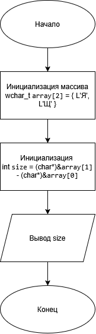

# Домашнее задание к работе 12

## Условие задачи
Напишите программу, которая вычисляет размер основных типов данных в байтах: wchar_t
!НЕЛЬЗЯ ПОЛЬЗОВАТЬСЯ sizeof  и КОНСТАНТАМИ ИЗ limits.h и float.h

## 1. Алгоритм и блок-схема

### Алгоритм
1. **Начало**
2. Инициализация массива
   - wchar_t `array[2]` = { L'Я', L'Щ' }
3. Инициализация переменной
   - int `size` = (char*)&`array[1]` - (char*)&`array[0]`
4. Вывод `size`
5. **Конец**

### Блок-схема
 

## 2. Реализация программы

```
#define _CRT_SECURE_NO_WARNINGS
#include <stdio.h>
#include <locale.h>


int main() {
	setlocale(LC_CTYPE, "RUS");

	wchar_t array[2] = { L'Я', L'Щ' };
	
	int size = (char*)&array[1] - (char*)&array[0];

	printf("Тип wchar_t занимает %d байт", size);

	return 0;
}
```

## 3. Результаты работы программы

```
Тип wchar_t занимает 2 байт
```

## 4. Информация о разработчике

Лупачев Сергей бТИИ-262
